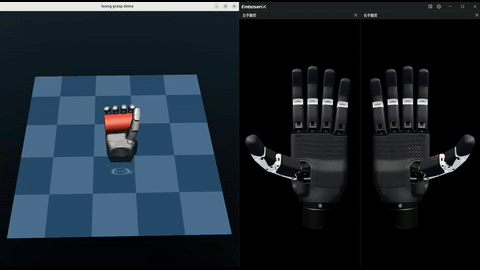
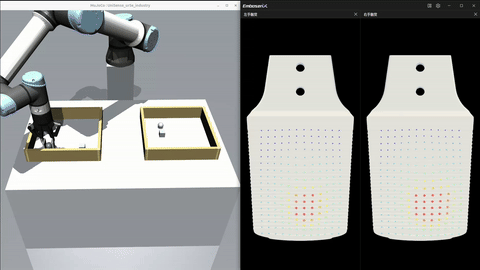
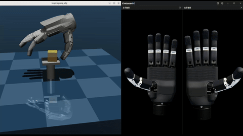
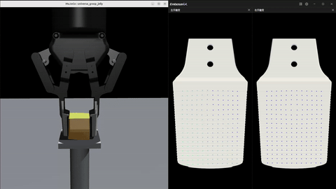
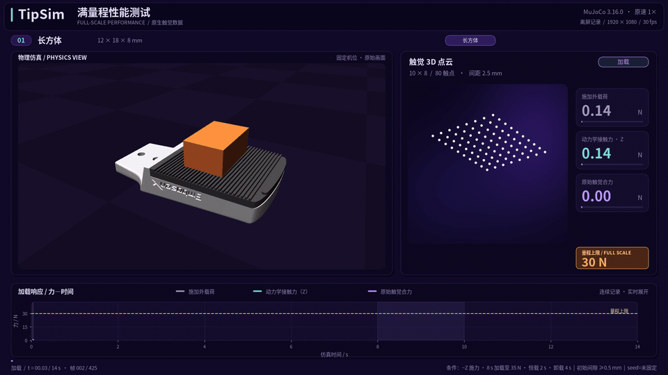
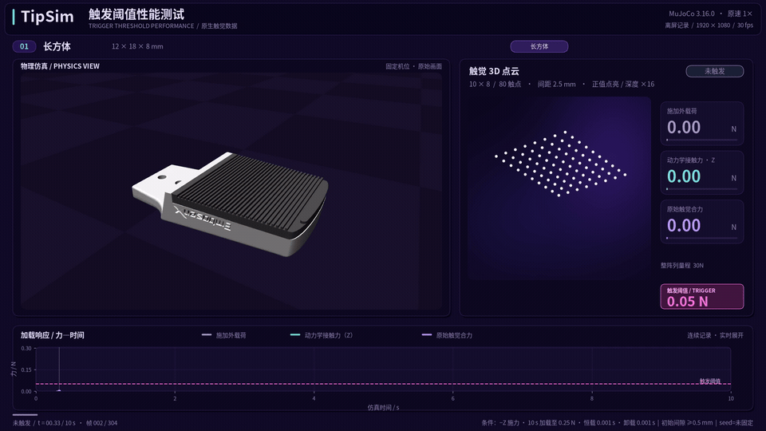
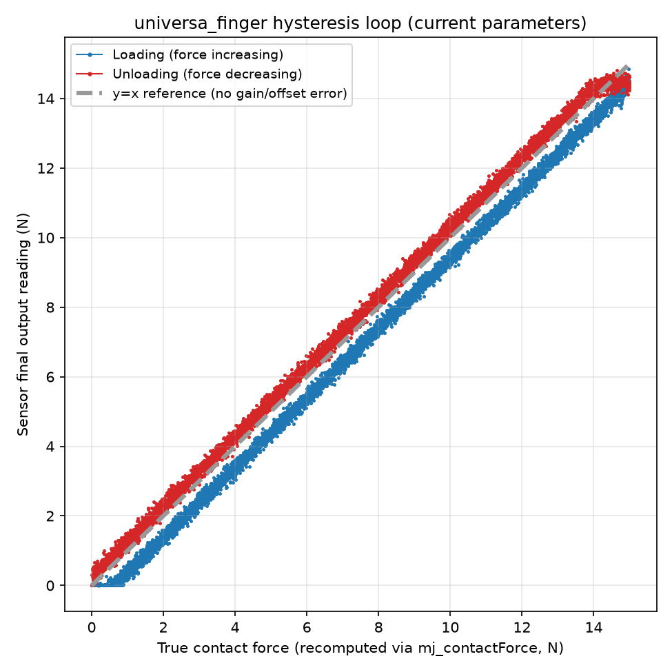

<p align="center"><b>English</b> | <a href="README.zh-CN.md">简体中文</a></p>

<h1 align="center">TipSim</h1>

**TipSim** is Tip's open integration project for robot tactile simulation. It provides ready-to-run MuJoCo tactile sensor plugins, scene models, and Python / C++ samples. From continuous sensing of contact regions and force distributions to tactile feedback for grasp control, TipSim helps you study sensing and control under controlled, reproducible conditions and reuse its interfaces and scenes in your own robot tasks.

This repository provides **integration interfaces, scene assets, and sample projects for the Loong and Universa tactile simulation sensor series**. The sensor implementations ship as precompiled runtime plugins; you load them and read their output through MuJoCo's standard sensor interface.

## Demo

| Dexterous Hand Grasp (Loong) | UR5e Pick-and-Place (Universa) |
| --- | --- |
|  |  |
| [Full video](data/videos/rh56e2_hold_cylinder.mp4) | [Full video](data/videos/universa_pick_and_place.mp4) |
| **Soft-Body Grasp Tactile Sensing (Loong)** | **Soft-Body Grasp Tactile Sensing (Universa)** |
|  |  |
| [Full video](data/videos/rh56e2_grasp_jelly.mp4) | [Full video](data/videos/universa_grasp_jelly.mp4) |

## Highlights

- 📊 **Continuous sensing of contact regions and force distributions**: Loong / Universa tactile arrays continuously output per-taxel force readings, showing where contact occurs, how force is distributed, and how it changes during loading and holding. Samples such as single-finger pressing provide array readings and total-force data to help analyze contact alongside object motion.
- 🔄 **Dynamics solving coupled with tactile feedback control**: TipSim relies on MuJoCo's native constraint solver to support numerically stable contact responses and brings tactile feedback into the grasp control loop. Pick-and-place and soft-body grasp samples stop gripper closure when tactile total force reaches a threshold, then lift, hold, and place the object, demonstrating the path from sensing to action decisions.
- ⚙️ **Configurable sensor characteristics and reproducible experiments**: configure full scale, accuracy, repeatability, trigger force, and hysteresis through XML without changing the plugin. Repeat experiments with the same environment, model, control configuration, and random seeds to compare sensor parameters and control strategies. See the [parameter comparisons](#sensor-parameter-customization) below for full scale, trigger force, and hysteresis.
- 📦 **Multiple MuJoCo versions, reusable interfaces and scene assets**: precompiled Linux x86_64 plugins support **all eight minor releases from MuJoCo 3.9.0 through 3.16.0**. Load them with `mj_loadPluginLibrary()` and read tactile data through standard `mjData.sensordata`, with no extra tactile SDK or plugin headers. Python / C++ samples, [ROS2 publishing](samples/README.md#ros2-tactile-publishing), and reusable gripper, dexterous-hand, and UR5e arm scenes and meshes help you integrate tactile sensing into your own robot tasks.

## Supported Plugins

| Plugin | Description | Example |
| --- | --- | --- |
| `tip.tactile.loong` | Multi-taxel / multi-surface array tactile sensing | Standalone array, RH56E2 dexterous-hand grasp |
| `tip.tactile.universa` | Array tactile sensing for grippers / fingertips | Single-finger pressing, UR5e pick-and-place |

## Sensor Parameter Customization

Both plugins expose their sensor characteristics through XML `<config>` elements. Besides the array's structural parameters (`size`/`coords`/`npoints`, etc. — see [Use TipSim in Your Own Project](#use-tipsim-in-your-own-project)), Loong and Universa share the following optional parameters, with the defaults shown below:

| Parameter | Meaning | Unit | Default |
| --- | --- | --- | --- |
| `full_scale` | Full scale: upper bound on the whole array's total force | N | Loong 20 / Universa 30 |
| `accuracy` | Accuracy error | % of full scale (%FS) | 1.0 |
| `repeatability` | Repeatability error | % of full scale (%FS) | 0.7 |
| `trigger_force` | Trigger force | N | 0.05 |
| `hysteresis_loop` | Hysteresis loop width: the reading gap between the loading/unloading curves | % of full scale (%FS) | 0.5 |
| `hysteresis_asymmetry` | Hysteresis asymmetry coefficient | dimensionless | 1.2 |
| `seed` | Master random seed: drives the accuracy error and repeatability noise | unsigned integer | random (differs every run) |

Add a `<config>` under `<plugin>` for each parameter. The following fragment shows the sensor characteristics in the current [universa_finger.xml](samples/tip/scene/universa_finger.xml) scene: full scale 30 N, fixed seed 1, and the defaults listed above. The array layout must also be configured explicitly; see [Step 2](#step-2--declare-the-sensor-in-the-mujoco-xml).

```xml
<sensor>
  <plugin name="my_tactile" plugin="tip.tactile.universa" objtype="site" objname="my_tactile_site">
      <config key="full_scale" value="30"/>
      <config key="accuracy" value="1.0"/>
      <config key="repeatability" value="0.7"/>
      <config key="trigger_force" value="0.05"/>
      <config key="hysteresis_loop" value="0.5"/>
      <config key="hysteresis_asymmetry" value="1.2"/>
      <config key="seed" value="1"/>
  </plugin>
</sensor>
```

A fixed `seed` makes the sensor's accuracy error and repeatability noise reproducible. When comparing repeated experiments, also keep the MuJoCo version, runtime environment, scene model, sensor parameters, and control configuration the same. All bundled sample scenes use fixed sensor seeds; see the [sample reproducibility notes](samples/README.md#reproducible-runs-random-seed).

The following demonstrations show how these parameters affect the readings:

| Parameter and test description | Visualization |
| --- | :---: |
| `full_scale`<br>Test setting: `full_scale=30` N. The applied load rises to 35 N over 8 s, holds for 2 s, then unloads over 4 s, showing the total-force reading saturating near full scale. | <br>[Full video](data/videos/universa_finger_full_scale_test.mp4) |
| `trigger_force`<br>Test settings: `trigger_force=0.05` N and `full_scale=30` N. The applied load rises to 0.25 N over 10 s, showing the response around the trigger threshold. | <br>[Full video](data/videos/universa_finger_trigger_test.mp4) |
| `hysteresis_loop` / `hysteresis_asymmetry`<br>A hysteresis loop of adjustable width appears between the loading and unloading curves. |  |

## Requirements

To use the plugins provided by this repository (not counting running the samples), you only need:

- Linux x86_64
- MuJoCo **any minor release from 3.9.0 through 3.16.0** (3.9.0, 3.10.0, 3.11.0, 3.12.0, 3.13.0, 3.14.0, 3.15.0 and 3.16.0)
- Linux runtime libraries, including zlib (`libz.so.1`) and the C++ runtime (`libstdc++.so.6`)

Running/building the bundled Python / C++ samples needs additional dependencies (ROS2, GLFW, etc.) — see [samples/README.md](samples/README.md#requirements).

## Quick Start

Fastest way to see tactile sensing in action: just run the bundled samples (which include ROS2 publishing and C++ build instructions) — see [samples/README.md](samples/README.md).

To wire the plugin directly into your own project, see [Use TipSim in Your Own Project](#use-tipsim-in-your-own-project) below.

## Use TipSim in Your Own Project

Integrating TipSim takes three steps.

### Step 1 — Load the plugin before loading the XML

Python:

```python
import mujoco

mujoco.mj_loadPluginLibrary("lib/libtip_tactile_loong.so")
m = mujoco.MjModel.from_xml_path("your_scene.xml")
d = mujoco.MjData(m)
```

For Universa, just swap the plugin path:

```python
mujoco.mj_loadPluginLibrary("lib/libtip_tactile_universa.so")
```

C++:

```cpp
#include <mujoco/mujoco.h>

mj_loadPluginLibrary("lib/libtip_tactile_loong.so");

char error[1024] = {0};
mjModel* m = mj_loadXML("your_scene.xml", nullptr, error, sizeof(error));
mjData* d = mj_makeData(m);
```

### Step 2 — Declare the sensor in the MuJoCo XML

This repository requires explicit array dimensions or taxel count and coordinates for both plugins:

| Plugin | Array dimensions / taxel count | Taxel coordinates |
| --- | --- | --- |
| Loong | `size="rows cols"` | `coords`: `rows × cols` coordinate pairs |
| Universa | `npoints="count"` | `coords`: `npoints` coordinate pairs |

`coords` lists each taxel's local `(y, z)` coordinates in the sensor site's frame, in millimeters. The number of coordinate pairs must match the configured taxel count. For example, a 2×2 Loong array:

```xml
<extension>
  <plugin plugin="tip.tactile.loong"/>
</extension>

<sensor>
  <plugin
      name="my_tactile"
      plugin="tip.tactile.loong"
      objtype="site"
      objname="my_tactile_site">
    <config key="size" value="2 2"/>
    <config key="coords" value="-1 -1 1 -1 -1 1 1 1"/>
  </plugin>
</sensor>
```

For the same 2×2 layout with Universa, declare `tip.tactile.universa` in `<extension>` and in the sensor, and use `npoints` instead of `size`:

```xml
<extension>
  <plugin plugin="tip.tactile.universa"/>
</extension>

<sensor>
  <plugin
      name="my_tactile"
      plugin="tip.tactile.universa"
      objtype="site"
      objname="my_tactile_site">
    <config key="npoints" value="4"/>
    <config key="coords" value="-1 -1 1 -1 -1 1 1 1"/>
  </plugin>
</sensor>
```

The bundled Universa scenes explicitly configure the default 80-taxel layout: `npoints=80`, 10 rows × 8 columns, and 2.5 mm pitch. Copy the complete coordinate list from the corresponding scene.

> **Note**: the plugin identifies the force-sensing soft-pad geom by its **name suffix**, without a separate geom-selection setting:
>
> | Plugin | Default soft-pad suffix | Examples |
> | --- | --- | --- |
> | `tip.tactile.universa` | `finger_silicone` | `finger_silicone`, `right_finger_silicone`, `left_finger_silicone` |
> | `tip.tactile.loong` | `silicone` | `loong96_silicone`, `zhangxin_silicone`, `sz_zf_silicone` |
>
> When relying on automatic detection, name your soft-pad geoms so that they **end with** the matching suffix.

For the site, array layout, and mounting approach the sensor expects, it's best to directly reference and reuse the repository's sample scenes:

- `samples/tip/scene/loong96.xml`
- `samples/inspire/scene/rh56e2_hold_cylinder.xml`
- `samples/tip/scene/universa_finger.xml`
- `samples/tip/scene/universa_pick_and_place.xml`

For your first integration, we recommend copying the sensor configuration from whichever sample most closely matches your robot's structure, then adjusting the mounting pose and model assets.

### Step 3 — Read tactile data from `sensordata`

Read `sensordata` after calling `mj_step()` or `mj_forward()` to update the sensor values.

Python:

```python
import numpy as np
import mujoco

sensor_id = mujoco.mj_name2id(
    m, mujoco.mjtObj.mjOBJ_SENSOR, "my_tactile"
)
adr = m.sensor_adr[sensor_id]
dim = m.sensor_dim[sensor_id]

tactile = np.asarray(d.sensordata[adr:adr + dim])
```

For the `2 x 2` array above:

```python
tactile_map = tactile.reshape(2, 2)
print("total:", tactile_map.sum())
print("peak:", tactile_map.max())
```

C++:

```cpp
int sid = mj_name2id(m, mjOBJ_SENSOR, "my_tactile");
int adr = m->sensor_adr[sid];
int dim = m->sensor_dim[sid];

for (int i = 0; i < dim; ++i) {
    mjtNum value = d->sensordata[adr + i];
    // use tactile value
}
```

From the user's side, TipSim sensors work exactly like any other MuJoCo sensor.

## Repository Layout

```text
TipSim/
├── lib/
│   ├── libtip_tactile_loong.so
│   └── libtip_tactile_universa.so
│
├── samples/
│   ├── README.md
│   ├── README.zh-CN.md
│   ├── common/
│   │   ├── tactile_ros2.py
│   │   └── tactile_ros2.h
│   │
│   ├── tip/
│   │   ├── assets/
│   │   ├── cpp/
│   │   ├── python/
│   │   └── scene/
│   │
│   └── inspire/
│       ├── assets/
│       ├── cpp/
│       ├── python/
│       └── scene/
│
├── CMakeLists.txt
├── ROADMAP.md
├── ROADMAP.zh-CN.md
├── LICENSE
├── README.md
└── README.zh-CN.md
```

- `lib/`: precompiled tactile sensor plugins loaded by MuJoCo.
- `samples/`: Python / C++ samples, ROS2 publishing, build and troubleshooting notes — see [samples/README.md](samples/README.md).
- `CMakeLists.txt`: only used to build the C++ samples.

## Roadmap

See [ROADMAP.md](ROADMAP.md).

## Contributing

Issues and pull requests are welcome around:

- New robot / gripper / dexterous-hand integration samples;
- Scene models and asset adaptation;
- Python / C++ usage examples;
- Documentation, build, and compatibility issues;
- Feedback on the TipSim API and overall experience.

The tactile plugins' internal implementation is out of scope for this repository's open-source contributions.

## License

Except for the precompiled binaries under `lib/`, everything in this repository — scene XML, Python / C++ samples, build scripts, and documentation — is licensed under the MIT License; see [LICENSE](LICENSE).

The TipSim tactile sensor plugins under `lib/` are precompiled binary components and are not covered by the MIT License. Unless otherwise agreed in writing, you may not decompile, reverse-engineer, or redistribute these plugins separately from this repository.
