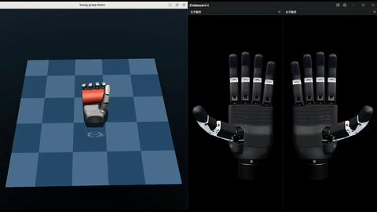
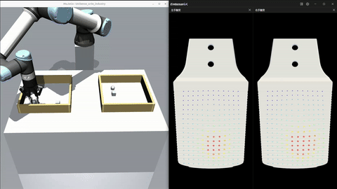
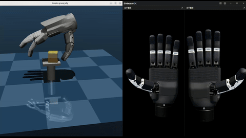
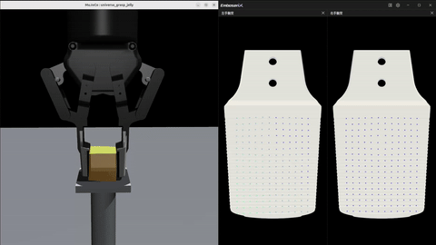
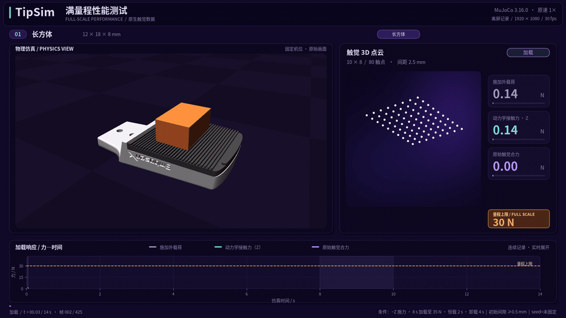
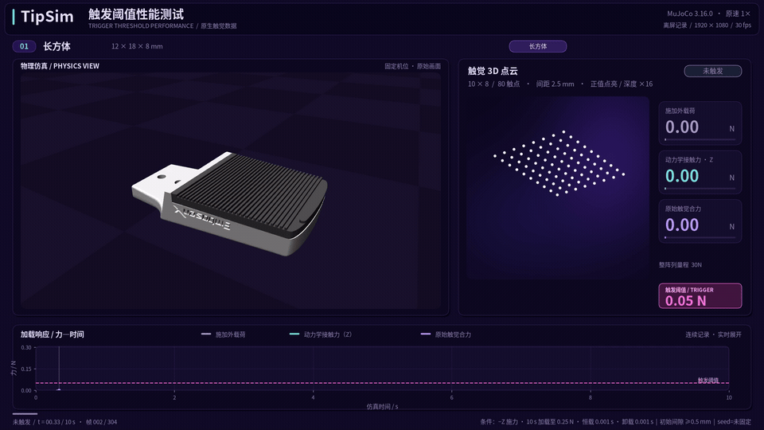
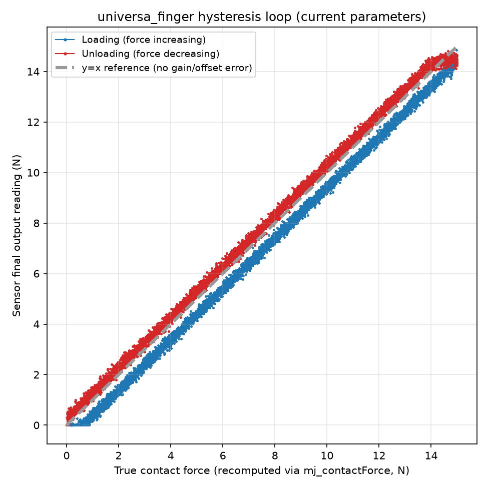

<p align="center"><a href="README.md">English</a> | <b>简体中文</b></p>

<h1 align="center">TipSim</h1>

**TipSim** 是华威科 TIP 平台面向机器人触觉仿真的开放集成项目，提供可直接运行的 MuJoCo 触觉传感器插件、场景模型以及 Python / C++ 示例。从接触区域与受力分布的持续感知，到触觉反馈参与抓取控制，TipSim 帮助用户在可控、可复现的条件下研究触觉与控制，并将已有接口和场景复用于自己的机器人任务。

本仓库提供**龙鳞（Loong）和万象（Universa）系列触觉仿真传感器的使用接口、场景资源和示例工程**。传感器实现以预编译插件形式提供，用户可通过 MuJoCo 标准传感器接口加载插件并读取数据。

## 效果展示

| 灵巧手抓握（Loong） | UR5e 取放（Universa） |
| --- | --- |
|  |  |
| [完整视频](data/videos/rh56e2_hold_cylinder.mp4) | [完整视频](data/videos/universa_pick_and_place.mp4) |
| **软体抓取触觉感知（Loong）** | **软体抓取触觉感知（Universa）** |
|  |  |
| [完整视频](data/videos/rh56e2_grasp_jelly.mp4) | [完整视频](data/videos/universa_grasp_jelly.mp4) |

## Highlights

- 📊 **接触区域与受力分布的持续感知**：Loong / Universa 阵列触觉传感器持续输出各触点的力值，帮助观察接触在哪里、力如何分布，以及加载和保持阶段的变化。单指按压等示例提供阵列读数与合力数据，便于对照物体运动分析接触过程。
- 🔄 **动力学求解与触觉反馈控制协同**：依托 MuJoCo 原生约束求解，兼顾接触响应的数值稳定性，并将触觉反馈接入抓取控制闭环。取放与软体抓取示例在触觉合力达到阈值后停止闭合，再执行抬起、保持和放回，展示从感知到动作决策的完整流程。
- ⚙️ **传感器特性可配置、实验可复现**：通过 XML 配置量程、精度、重复度、触发力和迟滞，无需修改插件。在相同环境、模型、控制配置和随机种子下重复实验，便于比较传感器参数与控制策略。下方提供量程、触发力和迟滞的[对比示例](#传感器参数自定义)。
- 📦 **多版本适用，开发接口和场景资产可复用**：Linux x86_64 预编译插件兼容 **MuJoCo 3.9.0–3.16.0 八个次版本**。通过 `mj_loadPluginLibrary()` 加载，使用标准 `mjData.sensordata` 读取触觉，无需额外触觉 SDK 或插件头文件；配套 Python / C++、[ROS2 发布示例](samples/README.zh-CN.md#ros2-触觉发布)，以及夹爪、灵巧手、UR5e 机械臂等场景与 Mesh 资源，方便接入自己的机器人任务。

## Supported Plugins

| Plugin | Description | Example |
| --- | --- | --- |
| `tip.tactile.loong` | 面向多触点 / 多表面的阵列触觉仿真 | 独立阵列、RH56E2 灵巧手抓取 |
| `tip.tactile.universa` | 面向夹爪 / 指端的阵列触觉仿真 | 单指按压、UR5e 取放 |

## 传感器参数自定义

两款插件均可通过 XML `<config>` 元素配置传感器特性，无需修改插件本身。除阵列结构参数（`size`/`coords`/`npoints` 等，见 [Use TipSim in Your Own Project](#use-tipsim-in-your-own-project)）外，Loong / Universa 还支持以下通用参数，均为可选项，未指定时使用下表中的默认值：

| 参数 | 含义 | 单位 | 默认值 |
| --- | --- | --- | --- |
| `full_scale` | 量程：整阵列合力上限 | N | Loong 20 / Universa 30 |
| `accuracy` | 精度误差 | 占量程百分比 (%FS) | 1.0 |
| `repeatability` | 重复度误差 | 占量程百分比 (%FS) | 0.7 |
| `trigger_force` | 触发力 | N | 0.05 |
| `hysteresis_loop` | 迟滞回环宽度：加载/卸载曲线的读数差 | 占量程百分比 (%FS) | 0.5 |
| `hysteresis_asymmetry` | 迟滞不对称系数 | 无量纲 | 1.2 |
| `seed` | 随机数主种子：决定精度误差和重复度噪声 | 无符号整数 | 随机（每次运行不同） |

在 `<plugin>` 中添加 `<config>` 即可设置参数。以下片段展示当前 [universa_finger.xml](samples/tip/scene/universa_finger.xml) 场景的传感器特性：量程为 30 N，固定种子为 1，其余特性参数使用上表中的默认值。阵列布局也必须显式配置，详见下方 [Step 2](#step-2--在-mujoco-xml-中声明传感器)。

```xml
<sensor>
  <plugin name="my_tactile" plugin="tip.tactile.universa" objtype="site" objname="my_tactile_site">
      <config key="full_scale" value="30"/>
      <config key="accuracy" value="1.0"/>
      <config key="repeatability" value="0.7"/>
      <config key="trigger_force" value="0.05"/>
      <config key="hysteresis_loop" value="0.5"/>
      <config key="hysteresis_asymmetry" value="1.2"/>
      <config key="seed" value="1"/>
  </plugin>
</sensor>
```

固定 `seed` 可复现传感器的精度误差与重复度噪声；比较重复实验时，还应保持 MuJoCo 版本、运行环境、场景模型、传感器参数和控制配置一致。所有示例场景均已配置固定的传感器种子，详见[示例的可复现性说明](samples/README.zh-CN.md#可复现运行随机种子)。

以下演示展示这些参数对读数的影响：

| 参数与测试说明 | 效果展示 |
| --- | :---: |
| `full_scale`<br>测试配置：`full_scale=30` N。外载荷在 8 s 内升至 35 N，保持 2 s，再用 4 s 卸载，展示合力读数在量程附近饱和的过程。 | <br>[完整视频](data/videos/universa_finger_full_scale_test.mp4) |
| `trigger_force`<br>测试配置：`trigger_force=0.05` N、`full_scale=30` N。外载荷在 10 s 内升至 0.25 N，展示触发阈值附近的读数响应。 | <br>[完整视频](data/videos/universa_finger_trigger_test.mp4) |
| `hysteresis_loop` / `hysteresis_asymmetry`<br>加载曲线和卸载曲线之间出现宽度可调的迟滞回环。 |  |

## Requirements

使用本仓库提供的插件（不含运行示例）只需要：

- Linux x86_64
- MuJoCo **3.9.0 至 3.16.0 的任一次版本**（3.9.0、3.10.0、3.11.0、3.12.0、3.13.0、3.14.0、3.15.0、3.16.0）
- Linux 运行库，包括 zlib（`libz.so.1`）和 C++ 运行库（`libstdc++.so.6`）

运行/构建仓库自带的 Python / C++ 示例还需要 ROS2、GLFW 等额外依赖，见 [samples/README.zh-CN.md](samples/README.zh-CN.md#requirements)。

## Quick Start

最快看到触觉效果：直接跑仓库自带的示例（含 ROS2 发布和 C++ 构建方式），见 [samples/README.zh-CN.md](samples/README.zh-CN.md)。

想直接把插件接进自己的项目，见下方 [Use TipSim in Your Own Project](#use-tipsim-in-your-own-project)。

## Use TipSim in Your Own Project

接入 TipSim 只需要三个步骤。

### Step 1 — 在加载 XML 前加载插件

Python：

```python
import mujoco

mujoco.mj_loadPluginLibrary("lib/libtip_tactile_loong.so")
m = mujoco.MjModel.from_xml_path("your_scene.xml")
d = mujoco.MjData(m)
```

Universa 只需替换插件路径：

```python
mujoco.mj_loadPluginLibrary("lib/libtip_tactile_universa.so")
```

C++：

```cpp
#include <mujoco/mujoco.h>

mj_loadPluginLibrary("lib/libtip_tactile_loong.so");

char error[1024] = {0};
mjModel* m = mj_loadXML("your_scene.xml", nullptr, error, sizeof(error));
mjData* d = mj_makeData(m);
```

### Step 2 — 在 MuJoCo XML 中声明传感器

本仓库统一要求两款插件显式设置阵列规模和触点坐标：

| 插件 | 阵列规模 / 触点数 | 触点坐标 |
| --- | --- | --- |
| Loong | `size="行数 列数"` | `coords`：（行数 × 列数）组坐标 |
| Universa | `npoints="触点数"` | `coords`：`npoints` 组坐标 |

`coords` 依次给出各触点在传感器 site 局部坐标系中的 `(y, z)` 坐标，单位为毫米；坐标组数必须与配置的触点数一致。以 2×2 的 Loong 阵列为例：

```xml
<extension>
  <plugin plugin="tip.tactile.loong"/>
</extension>

<sensor>
  <plugin
      name="my_tactile"
      plugin="tip.tactile.loong"
      objtype="site"
      objname="my_tactile_site">
    <config key="size" value="2 2"/>
    <config key="coords" value="-1 -1 1 -1 -1 1 1 1"/>
  </plugin>
</sensor>
```

Universa 使用相同的 2×2 布局时，在 `<extension>` 和传感器中声明 `tip.tactile.universa`，并以 `npoints` 替代 `size`：

```xml
<extension>
  <plugin plugin="tip.tactile.universa"/>
</extension>

<sensor>
  <plugin
      name="my_tactile"
      plugin="tip.tactile.universa"
      objtype="site"
      objname="my_tactile_site">
    <config key="npoints" value="4"/>
    <config key="coords" value="-1 -1 1 -1 -1 1 1 1"/>
  </plugin>
</sensor>
```

仓库中的 Universa 场景均显式配置默认的 80 点布局：`npoints=80`、10 行 × 8 列、间距 2.5 mm。完整坐标列表可从对应场景中复制。

> **注意**：插件通过 **geom 名称后缀** 自动识别模型中用于感知接触力的硅胶垫，无需另行指定软垫 geom：
>
> | 插件 | 默认软垫名称后缀 | 举例 |
> | --- | --- | --- |
> | `tip.tactile.universa` | `finger_silicone` | `finger_silicone`、`right_finger_silicone`、`left_finger_silicone` |
> | `tip.tactile.loong` | `silicone` | `loong96_silicone`、`zhangxin_silicone`、`sz_zf_silicone` |
>
> 使用自动识别时，软垫 geom 的名称需以对应后缀结尾。

传感器对应的 site、阵列模型及安装方式建议直接参考并复用仓库中的示例场景：

- `samples/tip/scene/loong96.xml`
- `samples/inspire/scene/rh56e2_hold_cylinder.xml`
- `samples/tip/scene/universa_finger.xml`
- `samples/tip/scene/universa_pick_and_place.xml`

对于第一次集成，推荐从最接近自己机器人结构的示例复制传感器配置，再修改安装位姿和模型资源。

### Step 3 — 从 `sensordata` 读取触觉数据

调用 `mj_step()` 或 `mj_forward()` 更新传感器数值后，再读取 `sensordata`。

Python：

```python
import numpy as np
import mujoco

sensor_id = mujoco.mj_name2id(
    m, mujoco.mjtObj.mjOBJ_SENSOR, "my_tactile"
)
adr = m.sensor_adr[sensor_id]
dim = m.sensor_dim[sensor_id]

tactile = np.asarray(d.sensordata[adr:adr + dim])
```

对于上方的 `2 x 2` 阵列：

```python
tactile_map = tactile.reshape(2, 2)
print("total:", tactile_map.sum())
print("peak:", tactile_map.max())
```

C++：

```cpp
int sid = mj_name2id(m, mjOBJ_SENSOR, "my_tactile");
int adr = m->sensor_adr[sid];
int dim = m->sensor_dim[sid];

for (int i = 0; i < dim; ++i) {
    mjtNum value = d->sensordata[adr + i];
    // use tactile value
}
```

从用户侧看，TipSim 传感器与其他 MuJoCo sensor 的使用方式保持一致。

## Repository Layout

```text
TipSim/
├── lib/
│   ├── libtip_tactile_loong.so
│   └── libtip_tactile_universa.so
│
├── samples/
│   ├── README.md
│   ├── README.zh-CN.md
│   ├── common/
│   │   ├── tactile_ros2.py
│   │   └── tactile_ros2.h
│   │
│   ├── tip/
│   │   ├── assets/
│   │   ├── cpp/
│   │   ├── python/
│   │   └── scene/
│   │
│   └── inspire/
│       ├── assets/
│       ├── cpp/
│       ├── python/
│       └── scene/
│
├── CMakeLists.txt
├── ROADMAP.md
├── ROADMAP.zh-CN.md
├── LICENSE
├── README.md
└── README.zh-CN.md
```

- `lib/`：由 MuJoCo 加载的预编译触觉传感器插件。
- `samples/`：Python / C++ 示例、ROS2 发布、构建与排障说明，见 [samples/README.zh-CN.md](samples/README.zh-CN.md)。
- `CMakeLists.txt`：仅用于构建 C++ 示例。

## Roadmap

见 [ROADMAP.zh-CN.md](ROADMAP.zh-CN.md)。

## Contributing

欢迎围绕以下内容提交 Issue 或 Pull Request：

- 新的机器人 / 夹爪 / 灵巧手集成示例；
- 场景模型与资产适配；
- Python / C++ 使用示例；
- 文档、构建和兼容性问题；
- TipSim API 与使用体验建议。

触觉插件内部实现不属于本仓库开放范围。

## License

除 `lib/` 下的预编译二进制文件外，本仓库中的场景 XML、Python / C++ 示例、构建脚本和文档采用 MIT License，详见 [LICENSE](LICENSE)。

`lib/` 下的 TipSim 触觉传感器插件为预编译二进制组件，不包含在 MIT License 授权范围内。除非另有书面约定，不允许对这些插件进行反编译、逆向工程或脱离本仓库单独再分发。
